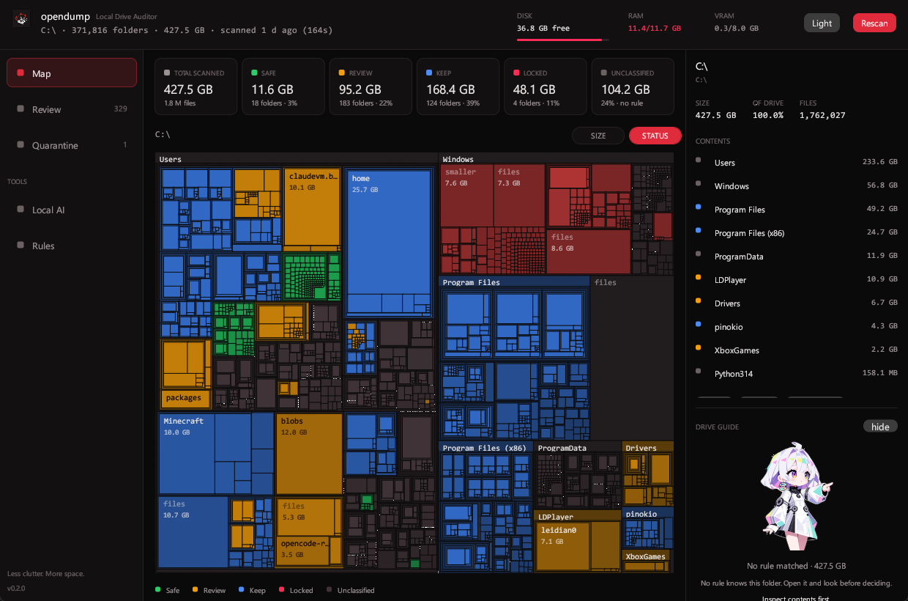
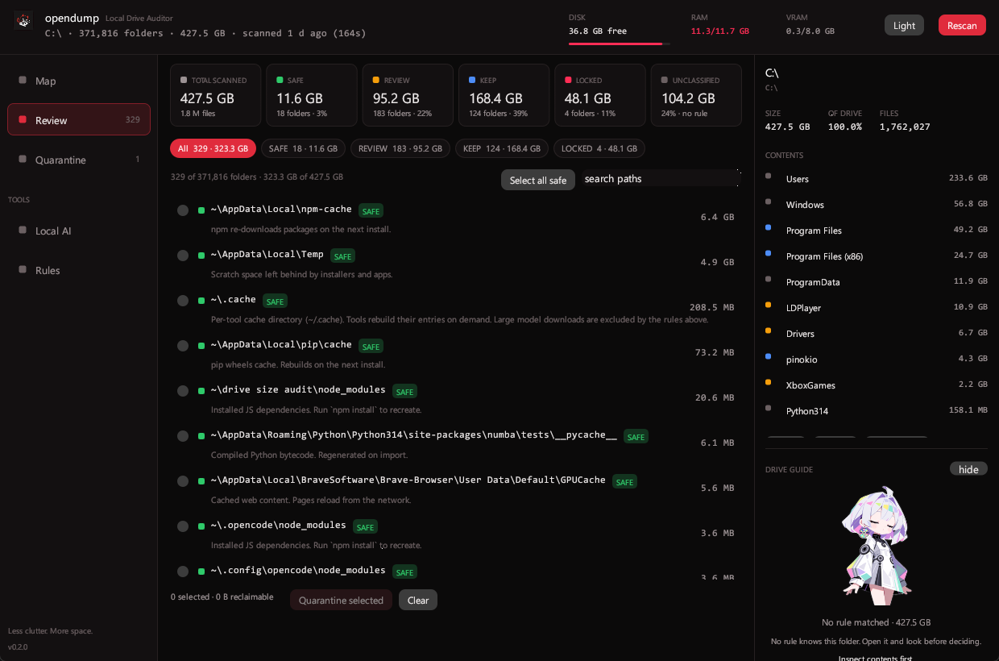
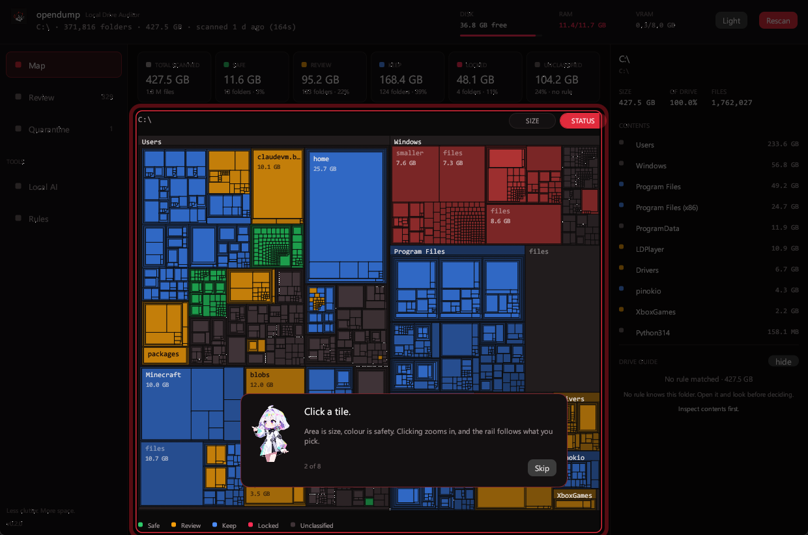
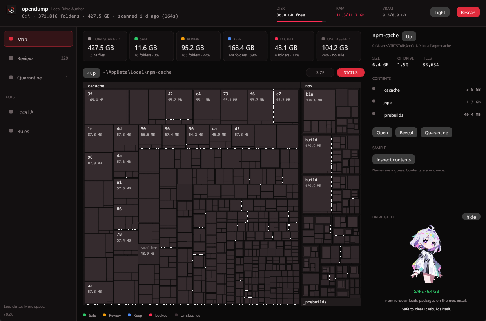

<p align="center">
  
</p>

<h1 align="center">opendump</h1>

<p align="center">
  <strong>A disk audit that explains itself.</strong><br>
  Sizes every folder on a Windows drive and tells you what is safe to remove —<br>
  one row, one reason, one checkbox at a time.
</p>

<p align="center">
  <a href="#install"></a>
  <a href="LICENSE"></a>
  <a href="#install"></a>
  <a href="#install"></a>
  <a href="#built-in-rust"></a>
</p>

<p align="center">
  
</p>

> **Measured on one machine, not estimated:** a full `C:\` scan in **4.9 s** reading the NTFS MFT,
> **89 MB** of RAM idle, **10.9 MB** to download, and **no runtime** — one binary, no webview.

`Get-ChildItem -Recurse` on 400 GB takes ten minutes and tells you nothing actionable. This tells you
what is on the drive, what it is, whether it comes back if you delete it — and then refuses to delete
anything until you say so twice.

---

## Contents

- [What it does](#what-it-does)
- [The one rule](#the-one-rule)
- [Install](#install)
- [First run](#first-run)
- [Risk tiers](#risk-tiers)
- [What the executor refuses](#what-the-executor-refuses)
- [Editing the rules](#editing-the-rules)
- [Built in Rust](#built-in-rust)
- [Privacy](#privacy)
- [Known limitations](#known-limitations)
- [Roadmap](#roadmap)

---

## What it does

- **Scans** a drive in parallel and caches the result, so the second open is instant.
- **Maps** it as a treemap: area is size, colour is risk. Click to drill in.
- **Classifies** every folder above 1 MB against a rule set you can read and edit.
- **Explains** every candidate — the category, why it is safe (or not), and what breaks if you
  remove it.
- **Quarantines** on a same-volume rename: instant, reversible, no free space needed.
- **Purges** only on a second, explicit confirmation that names the folders and the bytes.

<p align="center">
  
</p>

Rules decide. Nothing else does — not a heuristic, not a language model.

## The one rule

> **Nothing deletes without an explicit, acknowledged confirmation.** One module holds write power,
> it refuses what it did not classify as removable, and it journals its intent before touching disk.

Everything else in this README is a consequence of that sentence. The classifier has no write
capability at all, so a bug there can annoy you but cannot destroy anything. The executor re-checks
every path itself, refuses drive roots, refuses symbolic links, refuses anything outside a known
quarantine batch, and writes the plan to an append-only journal *before* the first rename.

## Install

Windows 10 or 11, x64. Nothing else is bundled.

**[Releases](https://github.com/masterdorime/opendump-v2/releases/latest)** — two artefacts, same app:

| | |
| --- | --- |
| `opendump-0.2.0-setup.exe` | Per-user installer, **5.8 MB**. No administrator prompt |
| `opendump-0.2.0-windows-x64.zip` | Portable, **5.3 MB**. Unzip anywhere and run |

The binaries are **unsigned**, so Windows says *"Unknown publisher"* the first time. That is expected
— signing needs a certificate this project does not have yet. *More info → Run anyway.*

The installer puts things in `%LOCALAPPDATA%\Programs\opendump`, adds a Start-menu entry, and on
uninstall it **leaves your quarantine folder alone** — anything staged there has not been deleted,
and an uninstaller has no business deciding that for you.

## First run

Press **Scan**. A full drive takes about five seconds if the app is elevated (it reads the NTFS MFT)
and 75–100 seconds otherwise (it walks the tree). The result is cached, so every later open is
instant.

**Kiroku-chan** — the guide in the right rail — walks you through the first scan: press Scan, click a
tile, open Review, pick a tier, tick a folder, quarantine it, restore it. Each step waits for the
real control, and the spotlight follows. She also restates what the matched rule said about whatever
folder you have selected, with the tier, the exclusive size and the reason. She is decoration with a
job: she can repeat what a rule decided, and she can never invent a verdict. You can hide her in
**Rules**.

<p align="center">
  
  
</p>

## Risk tiers

| Tier | Meaning | Selectable |
| --- | --- | --- |
| 🟢 `SAFE_PURGE` | Regenerates itself: package caches, shader caches, Temp, build output | yes |
| 🟡 `REVIEW` | Needs your judgement: model weights, emulator images, Downloads, app data | yes |
| 🔵 `KEEP` | Your data, or a folder containing it | yes, never pre-selected |
| 🔴 `LOCKED` | System-critical (`WinSxS`, `System32`, `Windows\Installer`) | **no** |

Two invariants worth knowing, because they are what make the totals honest:

**Nested folders never double-count.** A candidate reports its *exclusive* bytes — its own size minus
any nested candidates — so ticking a parent and its child never promises the same space twice.

**Protection is monotonic downward.** A `KEEP` folder protects everything beneath it. A parent holding
protected data is flagged `blocked` and is never removable as a whole.

## What the executor refuses

| Situation | Behaviour |
| --- | --- |
| `KEEP` / `LOCKED` tier | refused, even if the UI sends it |
| drive root (`C:\`) | refused |
| anything inside a quarantine folder | refused |
| a path on another volume than its staging root | staged on that volume instead |
| symbolic link or junction | refused |
| path vanished since the scan | skipped, with a reason |
| folder in use by another program | skipped with `EBUSY`/`EPERM` — apps are never force-closed |
| destination already exists | staged as `name (2)` rather than overwriting |

## Editing the rules

`rules/rules.json` is the whole classification system: plain JSON, ordered, first match wins. Matchers
on one rule are **ANDed**, so "this name, but only under that tree" is expressible:

```json
{
  "id": "purge-node-modules",
  "tier": "SAFE_PURGE",
  "reason": "Installed JS dependencies. Run `npm install` to recreate.",
  "match": { "prefix": "%PROGRAMFILES%", "name": "node_modules" },
  "requiresSibling": "package.json"
}
```

- `match.prefix` — path prefix, tokens expanded
- `match.name` — the final path segment
- `match.regex` — a full-path regular expression
- `requiresSibling` — only match when that file sits in the **parent** folder
- `display: true` — colours the map, is never a review item, and protects nothing

Your own rules go in `rules/overrides.json`, which is prepended so they win. The window compiles
`rules.json` in at build time, so editing it needs a rebuild, and a changed rule set invalidates the
scan cache: press **Rescan** and the new verdicts appear from a fresh read of the same drive.

**Exclude from scan** is in **Rules**: zoom into a folder on the map, exclude it, and both the walk
and the MFT reader skip it. The cache key includes the list, so the cached result stops answering the
moment you change it.

## Built in Rust

Three workspaces, one binary each, no runtime and no webview.

| | v0.5 (Electron) | this |
| --- | --- | --- |
| Full `C:\` scan | 172–299 s | **4.9 s** reading the NTFS MFT (elevated); ~75 s walking |
| Idle RAM | 377 MB, 4 processes | **89 MB, 1 process** |
| Download | 116.6 MB installer | **10.9 MB** exe, 5.8 MB installer |
| Runtime | Chromium + Node | **none** |

The scan is why the rewrite exists. Walking 1.7 million files is a filesystem problem, and reading
the **Master File Table** directly is a native-code problem: one bulk read of the volume's index
instead of hundreds of thousands of directory calls.

A webview was tried and **deleted**: a Tauri shell produced a 9.98 MB exe but pulled **316 MB of
WebView2** at runtime to draw one window that egui already drew in 10.9 MB with no runtime at all.

The rest of the receipts:

- **9,588 lines** of Rust across the core, the CLI and the window.
- **78 tests** (`cargo test --workspace`), including the invariants that keep deletion safe: exclusive
  sizing never exceeds the tree, protection blocks its parent, excluded folders are never read.
- **No async runtime.** Work runs on `std::thread` and results return over an `mpsc` channel.
- The rules are **data, not code**, so the classifier is testable without a disk.

```bash
cargo build --release              # the CLI
cd apps/native && cargo build --release   # the window
cargo test --workspace
```

## Privacy

No telemetry, no analytics, no network calls while scanning or cleaning. The scanner reads names and
sizes; it never reads file contents.

The **local AI** panel talks to Ollama on `127.0.0.1`, so nothing leaves the machine. A **cloud
endpoint** can be configured there instead — **off by default**, key held in memory for the session
only, and a *Show what would be sent* button that prints the exact payload before anything is sent:
folder path, size, file count and matched category. Never file names, never contents. That path has
**never been tested against a live endpoint**, and the UI says so.

## Known limitations

- **Windows only.** The scanner, path rules and executor are Win32-specific.
- **Unsigned binaries.** SmartScreen warns once on every download.
- **The cloud AI client is unverified.** The transport has never been exercised against a real
  endpoint; verdicts are capped at `REVIEW` regardless.
- **Multi-drive staging is unit-tested, not field-tested.** It routes to
  `<volume>:\DriveSizeAuditQuarantine`; this machine has one volume, so no real cross-volume move has
  been performed.
- **No elevated tier.** `hiberfil.sys`, the Windows Update cache and `WinSxS` are reported `LOCKED`
  and never touched — they cannot be deleted, only changed through `powercfg`, System Properties, a
  stopped service or `DISM`, and none of that comes back.
- **Purge is permanent.** Quarantine is the reversible step; the confirmation screen is the last one.
- **Quarantine lives under `%APPDATA%`.** Deleting that folder, or uninstalling without checking it,
  loses anything still staged there.
- **One machine so far.** Windows 11 only, one GPU, one display scaling.
- The mascot is **placeholder art** (AI renders), not final character work.

## Roadmap

1. **Code signing** — the only thing between downloadable and trustworthy.
2. **A live test of the cloud client**, then either promote it or remove it.
3. **Multi-drive proven** on a second physical volume.

Deliberately not planned: deleting `hiberfil.sys`, `pagefile.sys`, the Windows Update cache or
`WinSxS`. Reported, never touched.

## Contributing

The most useful contribution is **a rule**, not code — the classifier is data. A misclassified folder
is a `rules.json` bug, and the fix is a new rule *above* the general one it must outrank, plus a test
that asserts both the folder it should match and the neighbouring folder it must not.

For the engine, the architecture, and the traps that already cost time once, read
[AGENTS.md](AGENTS.md).

## License

[MIT](LICENSE) © 2026 masterdorime

**Use at your own risk.** This software moves and permanently deletes files. It is provided "as is",
without warranty of any kind. Keep a backup of anything you cannot re-download, read the confirmation
screen before you tick the box, and start with the `SAFE_PURGE` tier.
